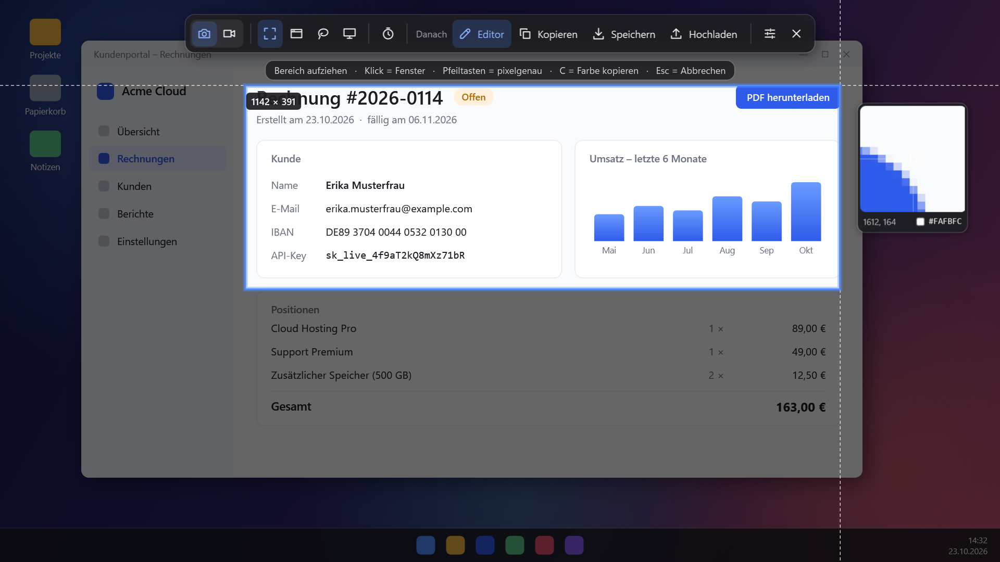
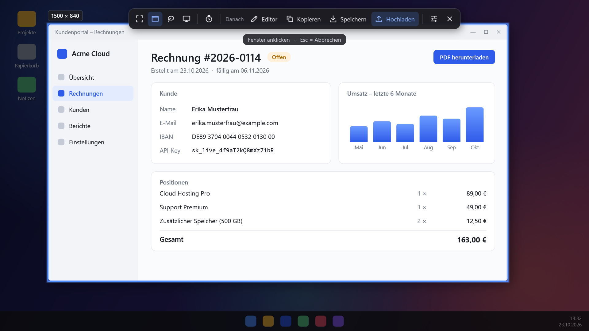
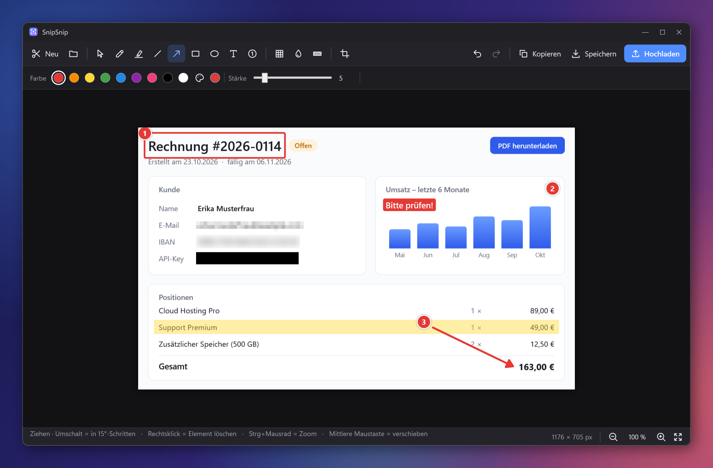
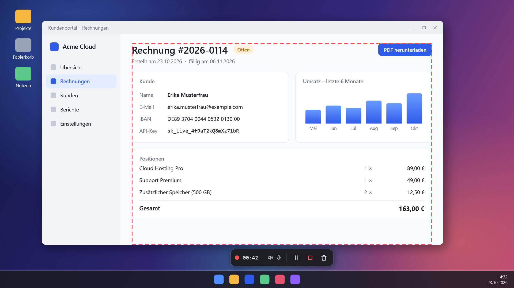
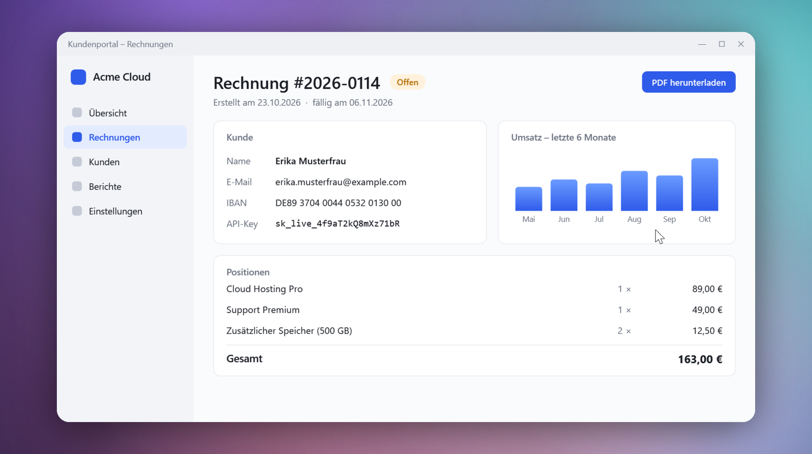
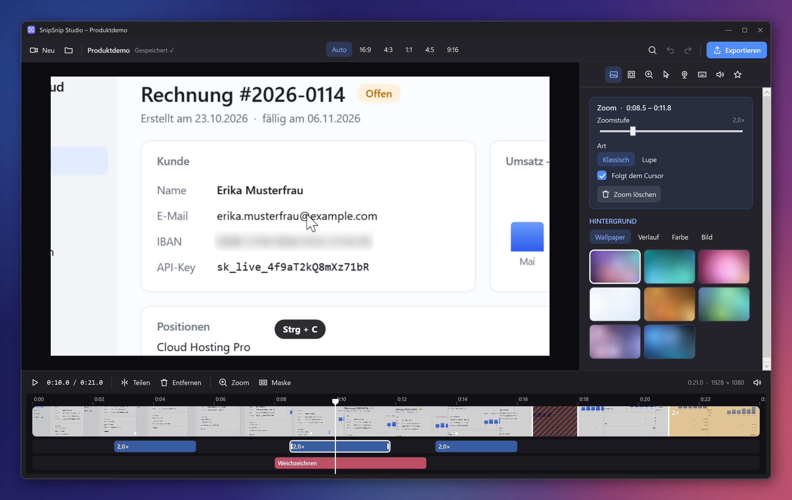
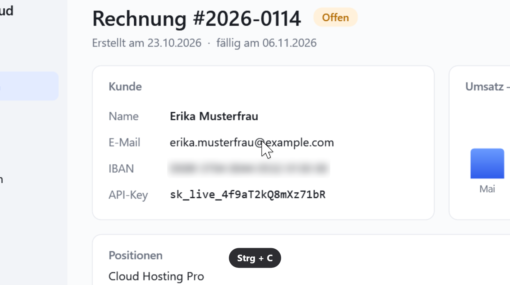
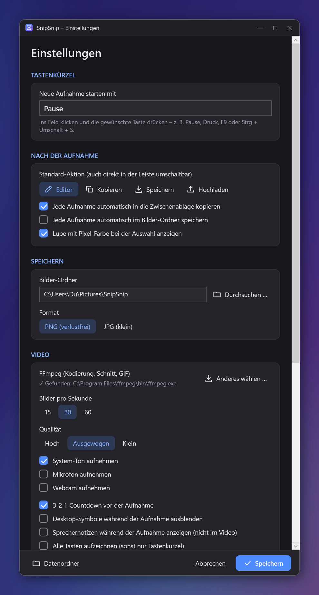
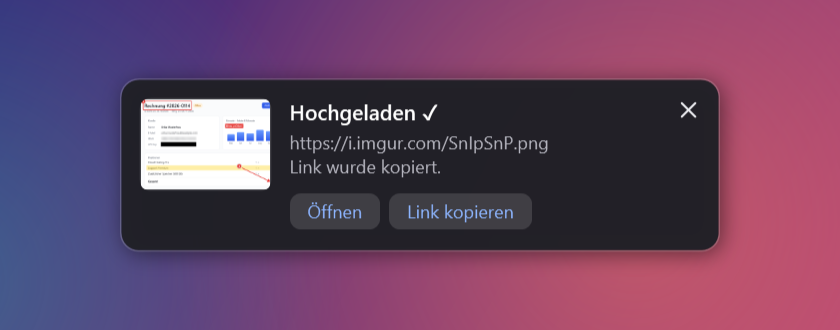

<div align="center">


# SnipSnip

**Ein schönes Snipping Tool für Windows: Screenshots und Bildschirmvideos im Stil von Screen Studio, mit Editor, Zensur, Auto-Zoom und Upload mit einem Klick.**

Drück <kbd>Pause</kbd>, zieh einen Bereich auf, und schon kannst du markieren, unkenntlich machen und teilen.

[**⬇ Download (neueste Version)**](../../releases/latest) · [Funktionen](#funktionen) · [Bauen](#selbst-bauen) · [Mitmachen](#mitmachen)

<br>



</div>

---

## Funktionen

### Die Leiste oben am Bildschirm

Ein Druck auf <kbd>Pause</kbd> friert den Bildschirm ein, und oben in der Mitte erscheint die Aufnahmeleiste. Dort wählst du alles direkt aus:

- **Foto oder Video:** ganz links zwischen Bildschirmfoto und Bildschirmvideo umschalten
- **Modus:** Rechteck, Fenster, Freihand oder Vollbild/Monitor (Tasten <kbd>1</kbd>–<kbd>4</kbd>)
- **Verzögerung:** Aufnahme nach 3, 5 oder 10 Sekunden
- **Danach:** im Editor öffnen, kopieren, speichern oder **direkt hochladen** (Imgur / catbox.moe). Der Link landet dann in der Zwischenablage.
- **Präzision:** Lupe mit Pixel-Koordinaten und Farbwert. Die Pfeiltasten bewegen den Zeiger pixelgenau, <kbd>C</kbd> kopiert die Farbe als Hex-Wert.
- **Schnell:** Ein Klick ohne Ziehen nimmt das Fenster unter dem Mauszeiger auf, <kbd>Strg</kbd>+Klick im Vollbild-Modus alle Monitore.



### Editor: markieren, beschriften, zensieren



| Werkzeug | Taste | |
|---|:---:|---|
| Auswählen & verschieben | <kbd>V</kbd> | <kbd>Entf</kbd> löscht, Rechtsklick löscht direkt |
| Stift · Textmarker | <kbd>P</kbd> · <kbd>M</kbd> | <kbd>Umschalt</kbd> = gerade Linie |
| Linie · Pfeil | <kbd>L</kbd> · <kbd>A</kbd> | <kbd>Umschalt</kbd> = 15°-Schritte |
| Rechteck · Ellipse | <kbd>R</kbd> · <kbd>E</kbd> | <kbd>Umschalt</kbd> = Quadrat/Kreis, optional gefüllt |
| Text | <kbd>T</kbd> | optional mit farbigem Hintergrund |
| Nummerierung | <kbd>N</kbd> | setzt fortlaufend ①②③ |
| **Verpixeln · Weichzeichnen · Schwärzen** | <kbd>X</kbd> · <kbd>B</kbd> · <kbd>S</kbd> | Die Pixel werden aus dem Originalbild neu berechnet. Hinter der Zensur bleibt nichts Lesbares übrig. |
| Zuschneiden | <kbd>C</kbd> | |

Außerdem gibt es Rückgängig/Wiederholen, Zoom (<kbd>Strg</kbd>+Mausrad), Verschieben der Ansicht mit der mittleren Maustaste und Drag & Drop von Bildern. Die Freihand-Aufnahme behält Transparenz.

### Bildschirmvideos wie mit Screen Studio

In der Leiste auf **Video** umschalten und einen Bereich, ein Fenster oder einen Monitor wählen. Nach einem kurzen 3-2-1-Countdown läuft die Aufnahme. Erneut <kbd>Pause</kbd> drücken beendet sie.



Wie bei Screen Studio wird **nicht einfach der Bildschirm abgefilmt**: SnipSnip zeichnet das Bild ohne Mauszeiger auf und speichert Mausbahn, Klicks, Tastenkürzel, Webcam, System-Ton und Mikrofon getrennt. Erst im Studio entsteht daraus das fertige Video. Darum lassen sich Zoom, Cursor, Hintergrund und Layout auch nachträglich ändern.



**Aufnahme**
- System-Ton, Mikrofon und **Webcam** direkt in der Leiste zuschalten. Alles bleibt synchron, auch bei Pause und Fortsetzen.
- Steuerleiste mit Laufzeit, Pause, Stopp und Verwerfen. Leiste, Rahmen und **Sprechernotizen** sind im Video unsichtbar.
- Desktop-Symbole ausblenden, Fenster vor der Aufnahme auf eine **exakte Größe** setzen (z. B. 1920 × 1080).
- Absturzsicher: Das Projekt wird laufend gespeichert und lässt sich nach einem Absturz wiederherstellen.
- Datenschutz: Bei normalem Tippen wird nur der Zeitpunkt gespeichert, nicht die Taste.

### Das Studio



| Bereich | Was geht |
|---|---|
| **Kamera & Zoom** | Automatische Zooms bei Klicks und Tastenkürzeln, manuelle Zooms auf der Zeitleiste, die Kamera folgt weich dem Cursor oder einem festen Punkt, Lupen-Zoom, Bewegungsunschärfe |
| **Cursor** | Geglättete Mausbahn, Größe, hochauflösender Cursor, Ausblenden im Ruhezustand, Klick-Effekte (Kreis oder Welle), Klick-Geräusche, Cursor-Loop |
| **Hintergrund & Rahmen** | Wallpaper, Verläufe, Farben, eigene Bilder (mit Unschärfe); Abstand, Innenrand, Ecken, Schatten (Deckkraft, Weichheit, Abstand, Winkel); Zuschnitt |
| **Format** | Auto, 16:9, 4:3, 1:1, 4:5 und 9:16 für Reels, TikTok und Shorts. Zoom und Webcam passen sich an. |
| **Webcam** | Layouts *Overlay*, *Geteilt*, *Nur Kamera* und *Nur Bildschirm*, auch abschnittsweise mit weicher Überblendung; Kreis, abgerundet oder eckig; weicht dem Cursor aus, verkleinert sich beim Zoomen, blendet sich bei Stille aus; Farbkorrektur und Schärfen |
| **Tastatur** | Tastenkürzel einblenden, lange Tipp-Phasen automatisch beschleunigen |
| **Bearbeitung** | Teilen, entfernen, beschleunigen (0,5× bis 8×); Masken (Weichzeichnen, Verpixeln, Abdecken mit Umgebungsfarbe, Hervorheben) direkt in der Vorschau ziehen; Rückgängig; Befehlspalette (<kbd>Strg</kbd>+<kbd>K</kbd>) |
| **Ton** | Lautstärke je Spur, Rauschunterdrückung (Standard/Podcast), Lautheit auf −16 LUFS, Hintergrundmusik in Schleife |
| **Export** | MP4 in 720p bis 4K mit 30/60 fps, optimierte GIFs bis 1080p, Kopieren als Datei (für Discord, Teams …), Hochladen zu Imgur oder catbox.moe |
| **Vorlagen** | Stile speichern und als Standard für neue Aufnahmen festlegen |



Tasten im Studio: <kbd>Leertaste</kbd> abspielen, <kbd>S</kbd> teilen, <kbd>Entf</kbd> entfernen, <kbd>Z</kbd> Zoom, <kbd>M</kbd> Maske, <kbd>L</kbd> Layout, <kbd>←</kbd>/<kbd>→</kbd> Bild für Bild, <kbd>Strg</kbd>+<kbd>E</kbd> exportieren, <kbd>Strg</kbd>+<kbd>K</kbd> Befehle. Vorhandene Videos lassen sich ebenfalls importieren und gestalten (ohne Cursor-Daten).

> Für Videos nutzt SnipSnip das freie [FFmpeg](https://ffmpeg.org). Fehlt es, bietet SnipSnip beim ersten Video an, es herunterzuladen: offizieller Build von [BtbN/FFmpeg-Builds](https://github.com/BtbN/FFmpeg-Builds), per SHA-256 geprüft. Alternativ: `winget install Gyan.FFmpeg`.
### Einstellungen & Benachrichtigungen

<table>
<tr>
<td width="46%"></td>
<td>

- Tastenkürzel frei wählbar (<kbd>Pause</kbd>, <kbd>Druck</kbd>, <kbd>F9</kbd>, <kbd>Strg</kbd>+<kbd>Umschalt</kbd>+<kbd>S</kbd> …)
- Jede Aufnahme automatisch kopieren und/oder speichern
- PNG oder JPG, eigene Ordner für Bilder und Videos
- Video: Bildrate, Qualität, Ton, Mauszeiger, Klick-Markierung, Countdown
- Upload zu **Imgur** (eigene Client-ID) oder **catbox.moe** (ohne Konto)
- Upload-Verlauf mit Lösch-Links für Imgur
- Start mit Windows (im Tray)

<br>



</td>
</tr>
</table>

## Installation

1. Lade die passende ZIP-Datei aus den [**Releases**](../../releases/latest) herunter:
   - `SnipSnip-x.y.z-win-x64.zip`: eigenständig, keine Installation nötig (empfohlen)
   - `SnipSnip-x.y.z-win-arm64.zip`: für Windows auf ARM
   - `SnipSnip-x.y.z-win-x64-requires-dotnet10.zip`: sehr klein, benötigt die [.NET 10 Desktop Runtime](https://dotnet.microsoft.com/download/dotnet/10.0)
2. Entpacken und `SnipSnip.exe` starten. Die App läuft im Tray.
3. <kbd>Pause</kbd> drücken. Fertig.

> **Tipp:** Wenn du die <kbd>Druck</kbd>-Taste als Kürzel nutzen willst, schalte unter *Windows-Einstellungen › Barrierefreiheit › Tastatur* die Option „Druck-Taste zum Öffnen des Bildschirmausschnitts verwenden“ aus.

### Imgur einrichten

Anonyme Uploads zu Imgur brauchen eine kostenlose Client-ID:

1. Registriere eine Anwendung unter <https://api.imgur.com/oauth2/addclient>.
2. Wähle „Anonymous usage without user authorization“.
3. Trag die Client-ID in den SnipSnip-Einstellungen ein.

Ohne Client-ID kannst du alternativ zu **catbox.moe** hochladen.

### Kommandozeile

| Aufruf | Wirkung |
|---|---|
| `SnipSnip.exe` | Startet im Tray. Läuft SnipSnip schon, startet direkt eine neue Aufnahme (praktisch als Taskleisten-Verknüpfung). |
| `SnipSnip.exe <datei>` | Öffnet ein Bild im Editor oder ein Video im Video-Editor (auch per „Öffnen mit …“) |
| `SnipSnip.exe --capture` | Startet sofort eine Aufnahme |
| `SnipSnip.exe --tray` | Startet still im Tray (wird für den Autostart verwendet) |
| `SnipSnip.exe --render-docs <ordner>` | Rendert die README-Bilder (siehe unten) |

Einstellungen und Upload-Verlauf liegen in `%APPDATA%\SnipSnip`.

## Selbst bauen

Voraussetzungen: Windows 10/11 und das [.NET 10 SDK](https://dotnet.microsoft.com/download/dotnet/10.0).

```bash
git clone <repo-url> && cd SnipSnip
dotnet build
dotnet run
```

Eine einzelne, eigenständige EXE baust du so:

```bash
dotnet publish -c Release -r win-x64 --self-contained true -p:PublishSingleFile=true -p:IncludeNativeLibrariesForSelfExtract=true -o dist
```

### README-Bilder neu rendern

Die Bilder in [`docs/images`](docs/images) sind **keine Screenshots**. SnipSnip rendert sie selbst aus den echten UI-Komponenten (Leiste, Overlay, Bild- und Video-Editor, Aufnahme-Leiste, Einstellungen, Toast). Der Hintergrund ist ein künstlicher Demo-Desktop mit fiktiven Daten. Nach UI-Änderungen genügt:

```bash
dotnet run -- --render-docs docs/images
```

Die CI rendert die Bilder bei jedem Push ebenfalls und hängt sie als Artefakt an. So fällt sofort auf, wenn eine UI-Komponente nicht mehr instanziiert werden kann.

### Release erstellen

Releases baut [GitHub Actions](.github/workflows/release.yml) automatisch, sobald ein Versions-Tag gepusht wird:

```bash
git tag v1.0.0
git push origin v1.0.0
```

Die Pipeline baut die drei Varianten (x64, ARM64 und die kleine .NET-abhängige EXE), erzeugt `SHA256SUMS.txt` und veröffentlicht alles als GitHub-Release mit automatisch generierten Release-Notes. Tags mit Bindestrich (z. B. `v1.1.0-beta.1`) erscheinen als Pre-Release.

## Projektstruktur

```
App.xaml(.cs)          Tray, globales Tastenkürzel, Single-Instance, Aktionen nach der Aufnahme
Capture/               Aufnahme-Session, Overlay pro Monitor, die Leiste oben, Countdown
Editor/                Bild-Editor, Annotationen (Formen, Text, Zensur)
Recording/             Videoaufnahme: Bild (GDI → FFmpeg), Ton (WASAPI), Webcam, Maus/Tasten, Steuerleiste
Studio/                Studio: Projektformat, Renderer (SkiaSharp), Kamera/Auto-Zoom, Zeitleiste, Export
Video/                 Vorschaubilder für Zeitleiste und Benachrichtigungen
Core/                  Bildschirmaufnahme, FFmpeg, Bild-Export, Upload, Einstellungen, Hotkey
UI/                    Einstellungen, Upload-Verlauf, Toast, FFmpeg-Einrichtung
Rendering/             Rendert die README-Bilder
.github/workflows/     CI (Build + Render) und Release
```

## Mitmachen

Issues und Pull Requests sind willkommen. Bitte:

- vor einem PR `dotnet build` ausführen. Die CI baut und rendert alle Oberflächen.
- bei sichtbaren UI-Änderungen die README-Bilder neu rendern (`--render-docs`) und mit einchecken.
- sich am bestehenden Stil orientieren: dunkles Design, Icons als Vektor-Geometrien in `App.xaml`, UI-Texte auf Deutsch.

## Lizenz

[MIT](LICENSE)
